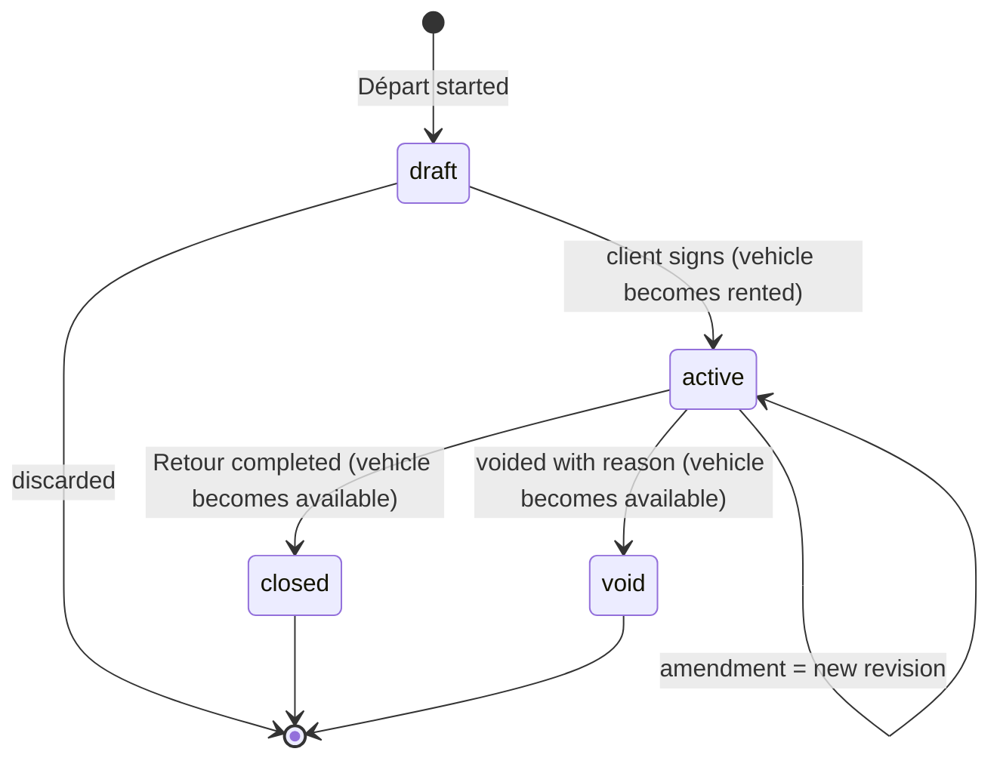
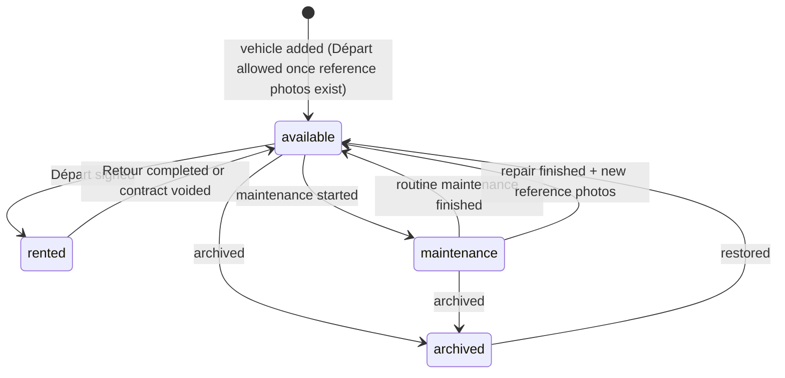

# ADR-0007: Contract and vehicle lifecycle: signed data is immutable, changes create revisions, everything is audited

| Status | Date | Decided by | Based on |
|---|---|---|---|
| **Accepted** | 2026-10-07 | Developer, with the client's answers | Brief · B-06, B-08 · defaults for R-09, R-11, R-12, R-13 |

## Context

- The brief prefers a history and audit trail to overwriting signed data.
- Staff must be able to extend or modify an active rental.
- Return information is added later, at the Retour.
- Both phones work on the same data at the same time.

## Decision

- **Contract:** a header (number, vehicle, renter, status) plus numbered **revisions**.
  - Revision 1 is the Départ as signed.
  - Each amendment, for example an extension, is a new revision with a full snapshot of the contract terms, a reason, its author and the time.
- **Snapshot:** at signature, a revision stores the client and vehicle values as printed. Later edits to the client or vehicle records never change a signed contract.
- **Retour:** a separate record added to the contract. It holds the return time, km, fuel, new damage or RAS, comments, the final pricing lines and an optional signature.
- **Contract states** (diagram below):
  - draft → active when the Départ is signed;
  - active → closed when the Retour is completed;
  - drafts can be discarded;
  - an active contract can be voided with a reason, but never deleted (default for R-12).
- **One active contract per vehicle:** enforced by a partial unique index and by the transition functions.
- **Write paths:**
  - The app never writes a status column directly. Contract, vehicle and damage statuses change only through server functions. These also switch the vehicle status in the same transaction.
  - Column-level grants keep the status columns read-only for the app's database role.
  - Unsigned draft revisions can be edited. Once signed, a revision is frozen.
- **Immutability:** database rules reject UPDATE and DELETE on:
  - signed revisions;
  - completed inspections;
  - signatures;
  - reference photo sets and photos;
  - damage descriptions and photos (only the repair status changes, through the maintenance function);
  - generated-PDF records;
  - audit events.

  In storage, the evidence buckets accept uploads and reads only ([ADR-0014](0014-file-storage.md)).
- **Audit trail:** triggers on every business table append a row to `audit_events` with the server time, the user, the action, the row, and the values before and after. These rows contain personal values, so they follow the retention procedure ([US-094](../stories/US-094-retention-and-erasure.md)).
- **Contract number:** `MCR-YYYY-NNNN`, assigned at signature from a yearly counter. Gaps are acceptable because it is not an invoice number (default for R-09).
- **Amendment signature:** if the client is present, they sign the amendment. If not, it is recorded « sans signature du client » (default for R-11). How amendments appear in the PDF is in [ADR-0009](0009-signatures.md).
- **Vehicle statuses:** available, rented, maintenance, archived (default for R-13). Their transitions are in the second diagram below.

## Consequences

**Positive**

- Every signed state can be reproduced exactly.
- Disputes can be investigated.
- Two phones can't rent the same car.

**Negative / risks**

- More tables and stricter write paths: state changes only happen through functions, and each one needs database tests.
- The PDF must show which values each signature covers ([ADR-0009](0009-signatures.md)).

## Alternatives considered

| Option | Why not chosen |
|---|---|
| Overwrite the contract and keep a history table | A bug or a mistaken edit could still change signed values |
| Full event sourcing | Too heavy for an app this size |

## Revisit when

Legal advice (L-01, L-07) requires a different evidence model.

## Implemented by

- [US-006](../stories/US-006-core-database-schema-and-rls.md): Create the core database schema, access rules and storage
- [US-007](../stories/US-007-audit-trail-and-immutability.md): Record an audit trail and protect signed data
- [US-024](../stories/US-024-edit-a-vehicle.md): Edit vehicle information
- [US-025](../stories/US-025-archive-a-vehicle.md): Archive and restore a vehicle
- [US-031](../stories/US-031-create-a-client.md): Create a client
- [US-032](../stories/US-032-edit-a-client.md): Edit a client
- [US-050](../stories/US-050-start-a-depart.md): Start a Départ by choosing an available vehicle
- [US-051](../stories/US-051-choose-renter-and-additional-driver.md): Choose the renter and the additional driver
- [US-056](../stories/US-056-resume-or-discard-a-draft.md): Resume or discard a draft Départ
- [US-057](../stories/US-057-sign-departure-server-function.md): Server function: sign a Départ
- [US-061](../stories/US-061-extend-or-amend-a-rental.md): Extend a rental or amend allowed fields
- [US-062](../stories/US-062-void-a-contract.md): Void a signed contract
- [US-064](../stories/US-064-amendment-pages-in-the-pdf.md): Amendment pages in the PDF
- [US-070](../stories/US-070-start-a-retour.md): Start a Retour
- [US-073](../stories/US-073-return-pricing-lines.md): Complete the pricing lines at the Retour
- [US-074](../stories/US-074-client-signs-the-retour.md): Client signs the Retour and the rental is closed
- [US-080](../stories/US-080-put-a-vehicle-into-maintenance.md): Put a vehicle into maintenance
- [US-082](../stories/US-082-finish-a-damage-repair.md): Finish a damage repair and refresh the reference photos
- [US-094](../stories/US-094-retention-and-erasure.md): Apply retention and erasure rules
