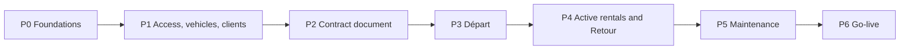

# User stories: MVP backlog

57 stories (49 Must, 6 Should, 2 Could), written from the brief, the
reference documents and the answers of 2026-10-07 and 2026-10-09, and revised after an independent review. Each story links the decisions
([`../adr/`](../adr/README.md)) and the open points ([`../discovery/open-questions.md`](../discovery/open-questions.md)) it
depends on.

## How to use this backlog

- **Files:** one file per story, `US-NNN-short-title.md`. The tens digit of the ID is the epic (US-05x = Départ).
- **Order:** work in phase order, P0 to P6. Start a story only when its dependencies are done. US-092 (legal questions) starts in P0, because its answers can change later stories.
- **Labels:**
  - "default for X-nn" in a criterion is a default for an open question (see open-questions § Defaults). If the answer changes, update the story **before** building it.
  - `RECOMMENDED` marks a technical choice that no question asked about.
  - `INTERPRETATION` marks a reading of an answer that has to be confirmed.
- **Priority:** **Must** = needed for the MVP; **Should** = MVP if time allows; **Could** = only if needed.
- **Status:** To do · In progress · Blocked · Done. Update the status line in the story file.
- **Size:** S ≈ up to 1 day, M ≈ 2–3 days, L ≈ 4–5 days, for one developer. These are rough guides for ordering, not commitments.
  - Must stories add up to roughly 95 developer-days (103 for everything).
  - Add time for learning React Native and iOS, and for waiting on Apple, the client and the lawyer.

## Definition of Ready

- Every dependency is done, or stubbed on purpose.
- Every open point the story cites is in one of these states:
  - answered;
  - covered by a default listed in open-questions § Defaults;
  - an external confirmation (L-xx), tracked in US-092, that doesn't block building.
- Questions with no default (T-02) must be answered before the stories that cite them.
- The acceptance criteria can be checked on a real iPhone or by an automated test.

## Definition of Done

- Every acceptance criterion is met.
- Stories with a user-facing part are demonstrated on a real iPhone with a staging build.
- Typecheck, lint, unit tests, HTML snapshot tests and database tests pass in CI.
- Any new table has RLS policies, and any state change goes through a server function. No bucket is public, and no service-role or S3 key is in the app.
- No real personal data appears in code, fixtures, seeds, screenshots, logs or crash reports.
- Any new UI text is in the French catalogue; any new contract text is in both catalogues.
- Every new write path is covered by the audit trail.
- Docs are updated. If a decision changed, a new ADR records it.

## Phases

### P0 · Foundations: accounts, repository, app skeleton, backend, builds, schema, spike, legal questions sent

- [US-001](US-001-apple-developer-account-and-devices.md) Open the Apple developer account and register the iPhones (Must, S)
- [US-002](US-002-repository-and-agent-guidance.md) Set up the repository, checks and agent guidance (Must, S)
- [US-003](US-003-expo-app-skeleton.md) Create the Expo app skeleton (Must, M)
- [US-004](US-004-supabase-environments.md) Create the Supabase environments (Must, S)
- [US-005](US-005-eas-builds-and-internal-distribution.md) Set up EAS builds, internal distribution and over-the-air updates (Must, M)
- [US-006](US-006-core-database-schema-and-rls.md) Create the core database schema, access rules and storage (Must, L)
- [US-007](US-007-audit-trail-and-immutability.md) Record an audit trail and protect signed data (Must, M)
- [US-009](US-009-spike-signature-and-pdf-on-iphone.md) Spike: prove signature capture and PDF generation on a real iPhone (Must, S)
- [US-014](US-014-crash-reporting.md) Report crashes without personal data (Should, S)
- [US-092](US-092-legal-and-privacy-checklist.md) Send the legal and privacy questions, and close them before go-live (Must, S)

### P1 · Access, vehicles and clients

- [US-010](US-010-sign-in-and-sign-out.md) Sign in and sign out (Must, M)
- [US-011](US-011-app-lock-with-face-id.md) Lock the app with Face ID (Must, S)
- [US-012](US-012-revoke-a-staff-members-access.md) Revoke a staff member's access (lost phone or departure) (Must, S)
- [US-020](US-020-home-screen.md) Home screen: Départ, Retour and the fleet (Must, M)
- [US-021](US-021-search-filter-sort-vehicles.md) Search, filter and sort vehicles (Must, S)
- [US-022](US-022-add-a-vehicle.md) Add a vehicle with its reference photos (Must, M)
- [US-023](US-023-vehicle-detail.md) Vehicle detail (Must, M)
- [US-024](US-024-edit-a-vehicle.md) Edit vehicle information (Must, S)
- [US-025](US-025-archive-a-vehicle.md) Archive and restore a vehicle (Should, S)
- [US-026](US-026-guided-reference-photo-capture.md) Guided reference photo capture (Must, M)
- [US-030](US-030-find-and-select-a-client.md) Find and select a client (Must, S)
- [US-031](US-031-create-a-client.md) Create a client (Must, M)
- [US-032](US-032-edit-a-client.md) Edit a client (Must, S)
- [US-033](US-033-client-documents.md) Attach and view client documents (Must, M)

### P2 · Contract document

- [US-013](US-013-minimum-local-data-on-phones.md) Keep client data on staff phones to a minimum (Must, S)
- [US-040](US-040-contract-pdf-template.md) Contract PDF template in French and English, with the signature block at the bottom right (Must, L)
- [US-041](US-041-general-terms-per-language.md) Manage the general terms (CGV) per language (Must, S)
- [US-042](US-042-archive-and-share-pdfs.md) Archive, download and share contract PDFs (Must, M)

### P3 · Départ

- [US-050](US-050-start-a-depart.md) Start a Départ by choosing an available vehicle (Must, M)
- [US-051](US-051-choose-renter-and-additional-driver.md) Choose the renter and the additional driver (Must, M)
- [US-052](US-052-fill-in-rental-details.md) Fill in the rental details (Must, M)
- [US-053](US-053-confirm-departure-condition.md) Confirm the departure condition (Must, M)
- [US-054](US-054-client-signs-the-depart.md) Client signs the Départ (Must, M)
- [US-055](US-055-departure-pdf.md) Generate the departure PDF in French or English (Must, M)
- [US-056](US-056-resume-or-discard-a-draft.md) Resume or discard a draft Départ (Should, S)
- [US-057](US-057-sign-departure-server-function.md) Server function: sign a Départ (Must, M)

### P4 · Active rentals and Retour

- [US-034](US-034-client-rental-history.md) Client rental history (Should, S)
- [US-060](US-060-active-rentals.md) See active rentals and expected returns (Must, S)
- [US-061](US-061-extend-or-amend-a-rental.md) Extend a rental or amend allowed fields (Must, M)
- [US-062](US-062-void-a-contract.md) Void a signed contract (Could, S)
- [US-063](US-063-reopen-or-regenerate-a-pdf.md) Re-open, re-share or regenerate a contract PDF (Should, S)
- [US-064](US-064-amendment-pages-in-the-pdf.md) Amendment pages in the PDF (Must, M)
- [US-070](US-070-start-a-retour.md) Start a Retour (Must, S)
- [US-071](US-071-return-km-and-fuel.md) Record the return km and fuel (Must, S)
- [US-072](US-072-return-inspection.md) Inspect the vehicle: new damage or RAS (Must, M)
- [US-073](US-073-return-pricing-lines.md) Complete the pricing lines at the Retour (Must, S)
- [US-074](US-074-client-signs-the-retour.md) Client signs the Retour and the rental is closed (Must, M)
- [US-075](US-075-final-pdf.md) Generate the final PDF in French or English (Must, S)

### P5 · Maintenance and condition reset

- [US-080](US-080-put-a-vehicle-into-maintenance.md) Put a vehicle into maintenance (Must, S)
- [US-081](US-081-finish-routine-maintenance.md) Finish a routine maintenance (Must, S)
- [US-082](US-082-finish-a-damage-repair.md) Finish a damage repair and refresh the reference photos (Must, M)
- [US-083](US-083-maintenance-history.md) Maintenance history (Should, S)

### P6 · Go-live: backups, retention, runbook, pilot

- [US-008](US-008-nightly-encrypted-backups.md) Run nightly encrypted backups and test a restore (Must, M)
- [US-090](US-090-import-existing-data.md) Import existing vehicles and clients (Could, S)
- [US-091](US-091-pilot-with-the-staff.md) Pilot with the two staff members (Must, M)
- [US-093](US-093-operations-runbook.md) Write the operations runbook (Must, S)
- [US-094](US-094-retention-and-erasure.md) Apply retention and erasure rules (Must, M)

## All stories

| ID | Story | Epic | Priority | Phase | Size | Depends on | Status |
|---|---|---|---|---|---|---|---|
| [US-001](US-001-apple-developer-account-and-devices.md) | Open the Apple developer account and register the iPhones | E0 | Must | P0 | S | — | To do |
| [US-002](US-002-repository-and-agent-guidance.md) | Set up the repository, checks and agent guidance | E0 | Must | P0 | S | — | To do |
| [US-003](US-003-expo-app-skeleton.md) | Create the Expo app skeleton | E0 | Must | P0 | M | US-002 | To do |
| [US-004](US-004-supabase-environments.md) | Create the Supabase environments | E0 | Must | P0 | S | US-002 | To do |
| [US-005](US-005-eas-builds-and-internal-distribution.md) | Set up EAS builds, internal distribution and over-the-air updates | E0 | Must | P0 | M | US-001, US-003 | To do |
| [US-006](US-006-core-database-schema-and-rls.md) | Create the core database schema, access rules and storage | E0 | Must | P0 | L | US-004 | To do |
| [US-007](US-007-audit-trail-and-immutability.md) | Record an audit trail and protect signed data | E0 | Must | P0 | M | US-006 | To do |
| [US-008](US-008-nightly-encrypted-backups.md) | Run nightly encrypted backups and test a restore | E0 | Must | P6 | M | US-006 | To do |
| [US-009](US-009-spike-signature-and-pdf-on-iphone.md) | Spike: prove signature capture and PDF generation on a real iPhone | E0 | Must | P0 | S | US-005 | To do |
| [US-010](US-010-sign-in-and-sign-out.md) | Sign in and sign out | E1 | Must | P1 | M | US-004, US-005, US-006 | To do |
| [US-011](US-011-app-lock-with-face-id.md) | Lock the app with Face ID | E1 | Must | P1 | S | US-010 | To do |
| [US-012](US-012-revoke-a-staff-members-access.md) | Revoke a staff member's access (lost phone or departure) | E1 | Must | P1 | S | US-010 | To do |
| [US-013](US-013-minimum-local-data-on-phones.md) | Keep client data on staff phones to a minimum | E1 | Must | P2 | S | US-026, US-033, US-042 | To do |
| [US-014](US-014-crash-reporting.md) | Report crashes without personal data | E1 | Should | P0 | S | US-005 | To do |
| [US-020](US-020-home-screen.md) | Home screen: Départ, Retour and the fleet | E2 | Must | P1 | M | US-010, US-006 | To do |
| [US-021](US-021-search-filter-sort-vehicles.md) | Search, filter and sort vehicles | E2 | Must | P1 | S | US-020 | To do |
| [US-022](US-022-add-a-vehicle.md) | Add a vehicle with its reference photos | E2 | Must | P1 | M | US-020, US-026 | To do |
| [US-023](US-023-vehicle-detail.md) | Vehicle detail | E2 | Must | P1 | M | US-022 | To do |
| [US-024](US-024-edit-a-vehicle.md) | Edit vehicle information | E2 | Must | P1 | S | US-023 | To do |
| [US-025](US-025-archive-a-vehicle.md) | Archive and restore a vehicle | E2 | Should | P1 | S | US-023 | To do |
| [US-026](US-026-guided-reference-photo-capture.md) | Guided reference photo capture | E2 | Must | P1 | M | US-005, US-006 | To do |
| [US-030](US-030-find-and-select-a-client.md) | Find and select a client | E3 | Must | P1 | S | US-006, US-010 | To do |
| [US-031](US-031-create-a-client.md) | Create a client | E3 | Must | P1 | M | US-030 | To do |
| [US-032](US-032-edit-a-client.md) | Edit a client | E3 | Must | P1 | S | US-031 | To do |
| [US-033](US-033-client-documents.md) | Attach and view client documents | E3 | Must | P1 | M | US-031 | To do |
| [US-034](US-034-client-rental-history.md) | Client rental history | E3 | Should | P4 | S | US-031, US-055 | To do |
| [US-040](US-040-contract-pdf-template.md) | Contract PDF template in French and English, with the signature block at the bottom right | E4 | Must | P2 | L | US-009, US-041 | To do |
| [US-041](US-041-general-terms-per-language.md) | Manage the general terms (CGV) per language | E4 | Must | P2 | S | US-006 | To do |
| [US-042](US-042-archive-and-share-pdfs.md) | Archive, download and share contract PDFs | E4 | Must | P2 | M | US-040, US-006 | To do |
| [US-050](US-050-start-a-depart.md) | Start a Départ by choosing an available vehicle | E5 | Must | P3 | M | US-020, US-022, US-006 | To do |
| [US-051](US-051-choose-renter-and-additional-driver.md) | Choose the renter and the additional driver | E5 | Must | P3 | M | US-050, US-030, US-031 | To do |
| [US-052](US-052-fill-in-rental-details.md) | Fill in the rental details | E5 | Must | P3 | M | US-050 | To do |
| [US-053](US-053-confirm-departure-condition.md) | Confirm the departure condition | E5 | Must | P3 | M | US-050, US-026 | To do |
| [US-054](US-054-client-signs-the-depart.md) | Client signs the Départ | E5 | Must | P3 | M | US-051, US-052, US-053, US-057, US-009 | To do |
| [US-055](US-055-departure-pdf.md) | Generate the departure PDF in French or English | E5 | Must | P3 | M | US-054, US-040, US-042 | To do |
| [US-056](US-056-resume-or-discard-a-draft.md) | Resume or discard a draft Départ | E5 | Should | P3 | S | US-050 | To do |
| [US-057](US-057-sign-departure-server-function.md) | Server function: sign a Départ | E5 | Must | P3 | M | US-007, US-041 | To do |
| [US-060](US-060-active-rentals.md) | See active rentals and expected returns | E6 | Must | P4 | S | US-054 | To do |
| [US-061](US-061-extend-or-amend-a-rental.md) | Extend a rental or amend allowed fields | E6 | Must | P4 | M | US-060, US-007 | To do |
| [US-062](US-062-void-a-contract.md) | Void a signed contract | E6 | Could | P4 | S | US-054 | To do |
| [US-063](US-063-reopen-or-regenerate-a-pdf.md) | Re-open, re-share or regenerate a contract PDF | E6 | Should | P4 | S | US-042, US-055 | To do |
| [US-064](US-064-amendment-pages-in-the-pdf.md) | Amendment pages in the PDF | E6 | Must | P4 | M | US-061, US-040, US-042 | To do |
| [US-070](US-070-start-a-retour.md) | Start a Retour | E7 | Must | P4 | S | US-060 | To do |
| [US-071](US-071-return-km-and-fuel.md) | Record the return km and fuel | E7 | Must | P4 | S | US-070 | To do |
| [US-072](US-072-return-inspection.md) | Inspect the vehicle: new damage or RAS | E7 | Must | P4 | M | US-070, US-026 | To do |
| [US-073](US-073-return-pricing-lines.md) | Complete the pricing lines at the Retour | E7 | Must | P4 | S | US-070 | To do |
| [US-074](US-074-client-signs-the-retour.md) | Client signs the Retour and the rental is closed | E7 | Must | P4 | M | US-071, US-072, US-073, US-007, US-009 | To do |
| [US-075](US-075-final-pdf.md) | Generate the final PDF in French or English | E7 | Must | P4 | S | US-074, US-064, US-040, US-042 | To do |
| [US-080](US-080-put-a-vehicle-into-maintenance.md) | Put a vehicle into maintenance | E8 | Must | P5 | S | US-023, US-074 | To do |
| [US-081](US-081-finish-routine-maintenance.md) | Finish a routine maintenance | E8 | Must | P5 | S | US-080 | To do |
| [US-082](US-082-finish-a-damage-repair.md) | Finish a damage repair and refresh the reference photos | E8 | Must | P5 | M | US-080, US-026, US-072 | To do |
| [US-083](US-083-maintenance-history.md) | Maintenance history | E8 | Should | P5 | S | US-080 | To do |
| [US-090](US-090-import-existing-data.md) | Import existing vehicles and clients | E9 | Could | P6 | S | US-006, US-008, US-092 | To do |
| [US-091](US-091-pilot-with-the-staff.md) | Pilot with the two staff members | E9 | Must | P6 | M | US-008, US-092, US-093, US-094 | To do |
| [US-092](US-092-legal-and-privacy-checklist.md) | Send the legal and privacy questions, and close them before go-live | E9 | Must | P0 | S | — | To do |
| [US-093](US-093-operations-runbook.md) | Write the operations runbook | E9 | Must | P6 | S | US-005, US-008, US-012 | To do |
| [US-094](US-094-retention-and-erasure.md) | Apply retention and erasure rules | E9 | Must | P6 | M | US-092, US-007, US-008 | To do |

## Post-MVP

These came up in the brief, the reference documents or the questions, and are deliberately left out of the MVP.

| Idea | Where it came from |
|---|---|
| Automatic totals and VAT | F-06 (may move into the MVP if the answer is yes) |
| Prices computed from rate cards, seasons, promotions | B-05 |
| Invoicing, e-invoicing, payments and deposits | B-04, B-10, L-04 |
| Offline mode | B-03 |
| Future bookings and a « Réservé » status | R-13 |
| Reminders for upcoming or overdue returns | N-05 |
| Reports and exports (rentals, utilisation) | N-04 |
| Remote signing of amendments, or an advanced/qualified e-signature | R-11, L-01 |
| Recording accidents and thefts (CGV Art. 5-3) | Source analysis |
| Damage costs and charges | R-10 |
| Vehicle swap during a rental | R-12 |
| Battery level for electric or hybrid cars | R-06 |
| Intermediary list and commissions | R-08 |
| Several roles and permissions, multi-factor authentication | R-16, ADR-0012 |
| English staff app, more contract languages | N-01, R-17 |
| Company phones under device management; distribution as a Custom app | ADR-0003, ADR-0013 |
| Automatic import from the client's current tool | T-02 |
